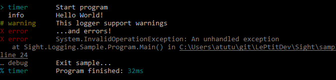
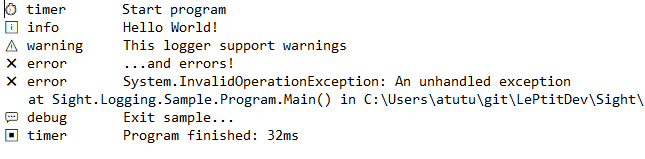

# Sight.Logging

[](https://www.nuget.org/packages/Sight.Logging/)

This library implement some loggers for console, file, memory, etc.

A log message is a tree of decorators (level, color, hyperlink, timestamp, category, rich text parts...) and each logger renders
it its own way: ANSI colors and clickable links for the console, emoji icons and plain text for files.

## Getting started

You can create a console logger and log some messages...

**Example:**
```csharp
var logger = new ConsoleLogger();
var stopwatch = logger.LogTimeStart("Start program");
logger.LogInformation("Hello World!");
logger.LogWarning("This logger support warnings");
logger.LogError("...and errors!");

try
{
    throw new InvalidOperationException("An unhandled exception");
}
catch (Exception ex)
{
    logger.LogError(ex);
}

logger.LogDebug("Exit sample...");
logger.LogTimeStop(stopwatch, "Program finished");
```

**Output:**



... or do the same thing with file.

**Example:**
```csharp
var logger = new FileLogger("logs.txt");
// ...
```

**Output:**



## Loggers

Availables loggers are:
- `ConsoleLogger` for console output
- `FileLogger` for file output
- `MemoryLogger` to keep logs in memory
- `NullLogger` to ignore all logs (`NullLogger.Instance`)
- `MixedLogger` to log each message in multiple loggers (a failing logger does not prevent the others from logging)
- `QueueLogger` to queue and process log messages
- `FilteredLogger` and `CategoryLogger`, created with `WithMinimumLevel(...)` and `For(...)`

Loggers never throw into the application: messages logged after a logger is disposed, or that cannot be written
(disk full, closed standard output), are ignored.

### Levels

`LogTrace`, `LogDebug`, `LogInformation`, `LogWarning`, `LogError`, `LogCritical` (the last two also accept an exception),
plus `LogTimeStart` / `LogTimeStop`. Levels are ordered (`LogLevels.Trace` < ... < `LogLevels.Critical`).

```csharp
var logger = new ConsoleLogger().WithMinimumLevel(LogLevels.Warning);
logger.LogInformation("ignored");
```

`WithMinimumLevel` filters before the message is built: the parameters are not formatted, and with an interpolated string
the interpolated values are not even evaluated. A custom logger can take part in this by implementing `ILogLevelFilter`.

### Messages

Parameters can be inserted with:
- `{0}`: the parameter at an index, `{name}`: the next parameter, with an optional format (`{0:N2}`, invariant culture)
- `%t` / `%e`: the next parameter displayed as a time span (`1.500s`) / as an exception (stack trace locations become links)
- `%%`, `{{` and `}}` for the literal characters

```csharp
logger.LogInformation("User {user} logged in {elapsed} ago", user, elapsed);
logger.LogInformation("Request took %t", elapsed);
```

A message without parameter is written as is, an unknown or unresolved placeholder is kept literally.
On .NET 6 and later, interpolated strings are supported too (not on `netstandard2.0`, use the placeholders above):

```csharp
logger.LogInformation($"User {user} logged in {elapsed} ago");
```

### Timestamps and categories

The creation time of a message is captured when it is logged (not when it is written, which matters in background mode) and
written before each message: ISO 8601 UTC with milliseconds for files, local `HH:mm:ss.fff` for the console. Use
`TimestampFormat` (`null` for none) and `UtcTimestamp` in the logger options to change it.

`logger.For("Http")` or `logger.For<MyService>()` tags the messages with a category, written as `[Http]` (nested categories are
joined: `Http.Client`).

### Console

```csharp
var logger = new ConsoleLogger(new ConsoleLoggerOptions
{
    ColorMode = ConsoleColorMode.Auto, // Auto (default): no ANSI sequence if NO_COLOR is set or the output is redirected
    Hyperlinks = true,                 // clickable links (OSC 8) for exceptions locations
    Utf8Output = true,                 // sets Console.OutputEncoding (process-wide, off by default)
    CreateThread = true                // write in a separated thread
});
```

Errors (and critical errors) are written to the error stream.

### File

```csharp
var logger = new FileLogger("logs/app.log", new FileLoggerOptions
{
    Append = true,                         // false to overwrite an existing file
    Encoding = Encoding.UTF8,              // UTF-8 without BOM by default
    MaxFileSize = 10 * 1024 * 1024,        // roll the file when it would exceed this size
    RollInterval = FileRollInterval.Daily, // or each hour
    MaxFiles = 7,                          // rolled files kept (app.20240310-235900.log, ...), oldest are deleted
    AutoFlush = true                       // flush after each message (synchronous mode)
});
```

Missing directories are created, the file can be read while it is written.

### Background mode

`ConsoleLogger` and `FileLogger` can write in a separated task (`CreateThread = true`, or the `createThread` parameter).
Messages go through a queue (`System.Threading.Channels`) that can be bounded:

```csharp
var logger = new FileLogger("logs.txt", new FileLoggerOptions
{
    CreateThread = true,
    Queue = new QueueOptions { Capacity = 10_000, FullMode = QueueFullMode.DropOldest, DisposeTimeout = TimeSpan.FromSeconds(5) }
});
```

`Dispose()` (or `DisposeAsync()`, available on all targets but `netstandard2.0`) stops accepting messages, waits for the queued
ones to be written (up to `DisposeTimeout`) then closes the output. The output is flushed each time the queue is empty.

### Security

Text parts are untrusted: control characters (including terminal escape sequences, `\r`, C1 and bidirectional controls) are written
as `\x1B` / `‮`, and a line break in a message is followed by an indentation under the log header, so a message cannot clear
the screen, spoof colors or links, or forge a log line. `HideStackTracePaths = true` removes the directories (absolute build paths)
from the stack trace locations of exceptions.

## Custom messages

Messages are plain objects: a `string`, or decorators built with `Log.ColoredLog`, `Log.HyperlinkLog`, `Log.RichLog`,
`Log.LeveledLog`, `Log.TimestampedLog`, `Log.CategorizedLog`... `Log.TimedLog` marks a time span (`ITimedLog.Time`) so custom
loggers can use it as a structured value, the text loggers write its formatted content. Custom icons and colors
(`Log.Icon(object)`, `Log.Color(object)`) are rendered by their text for icons and by `ConsoleColor`, `(byte, byte, byte)` RGB or
`"#RRGGBB"` values for colors.

## Microsoft.Extensions.Logging

See [Sight.Logging.Extensions](../Sight.Logging.Extensions/README.md) to use these loggers behind `ILogger<T>`.

## Migration from 0.1

- `%e` / `%t` parsing was fixed: a `%` followed by anything else is literal, `%%` is a literal percent.
- `LogDebug` now has the `Debug` level, and `LogLevels` has new `Trace` / `Critical` values (numeric values changed).
- `FileLogger` appends to an existing file by default (use `append: false` to overwrite), adds a timestamp, and sanitizes text.
- `ConsoleLogger` no longer sets `Console.OutputEncoding` (use `Utf8Output`), writes a timestamp, and drops ANSI sequences when the
  output is redirected.
- `QueueLogger.UnsafeMessages` is removed and `MemoryLogger.GetUnsafeMessages()` is obsolete (use `GetMessages()`).
